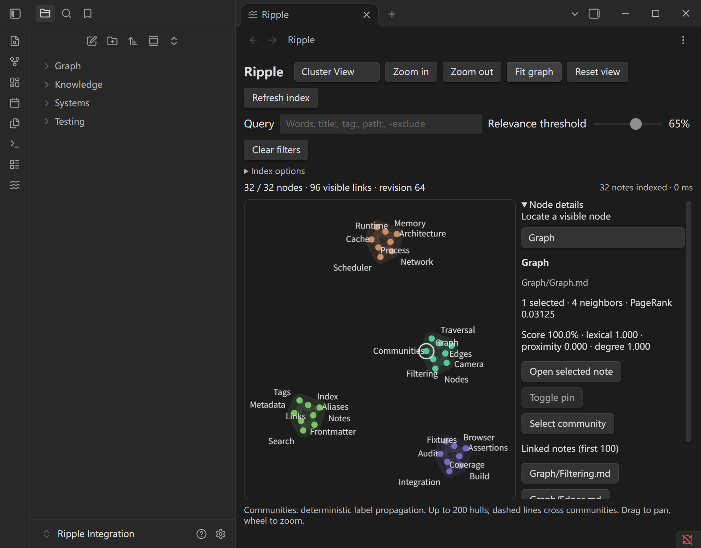

# Ripple

A local-first graph workspace for Obsidian, with shared relevance filtering and multiple graph views.

[](https://github.com/styayur/ripple/actions/workflows/ci.yml)
[](https://github.com/styayur/ripple/releases)
[](LICENSE)



The screenshot is from the production build in a real Windows Obsidian session
with a newly created synthetic vault. It is not a mock or an image-generated UI.

## What it does

- Opens a full workspace tab with pan, zoom, fit, node selection and note opening.
- Shares one Vault index, relevance score cache, filter and selection across four modes.
- Explains title, alias, tag, path, optional body, distance and degree contributions.
- Preserves independent cameras and layouts while switching modes.
- Updates changed metadata and links incrementally; slider input never rereads notes.
- Keeps note content, frontmatter, links and paths unchanged.

No other graph plugin is required. The four reference projects informed the
architecture; Ripple does not embed four plugin lifecycles or control their views.

## View modes

| Mode     | Implemented behavior                                                                      | Limits                                                                     |
| -------- | ----------------------------------------------------------------------------------------- | -------------------------------------------------------------------------- |
| Frontier | 2D force layout in a worker; node drag, pin/unpin, camera controls                        | Active physics moves unpinned nodes; large layouts can take time to settle |
| Dense    | Batched Canvas points, static grid, viewport culling and label/edge LOD                   | Edges hidden below 0.3×; at most 30,000 drawn links and 120 labels         |
| Cluster  | Folder-seeded label propagation, colored hulls, cross-community links and group selection | Heuristic grouping, not Louvain; at most 200 drawn hulls                   |
| Galaxy   | Actual 3D points/lines, perspective camera, orbit/pan/zoom and ray picking                | Requires WebGL 2; deterministic xyz layout, not a 3D force solver          |

All four were exercised in **real Obsidian 1.14.5 on Windows 11** using a
32-note isolated vault. Browser tests also exercise actual Canvas, WebGL and
Workers with a mocked host. Synthetic 50,000-node measurements are separate
from live compatibility evidence. See [validation](docs/VALIDATION.md).

## Relevance filtering

Enter words, quoted phrases or field terms: `title:Graph`, `alias:Reference`,
`tag:systems`, `path:Research`, `content:cache`, `Graph -path:Archive`.
Body matching requires **Index options → Include note text**. Queries are
keyword ranking, not AI or semantic understanding.

For a fixed graph and query, a node is eligible iff its score is at least the
threshold and no exclusion matches. Higher thresholds cannot add eligible
nodes; lower thresholds cannot remove them. Terms contribute to an average,
not Obsidian's Boolean search syntax. 0% keeps zero-score non-excluded nodes.
100% retains complete title/alias matches. Empty queries ignore the threshold
and restore all candidates. **Clear filters** restores the full graph.

Scoring is 85% lexical matching, 10% proximity and 5% normalized degree, with
the documented exact-match override. Expand **Node details** for the winning
field per term and score components. No bridge rule silently bypasses your
threshold. [Full scoring contract](docs/SCORING.md).

## Install and use

Requires desktop Obsidian **1.14.5+**. Only Windows 11 / 1.14.5 has real host
verification; other desktop versions/platforms and mobile are **NOT TESTED**.

1. Download `main.js`, `manifest.json` and `styles.css` from
   [Release 0.2.0](https://github.com/styayur/ripple/releases/tag/0.2.0).
2. Put the three files into `<vault>/<configDir>/plugins/ripple-graph-filter/`.
   Use your actual configuration directory; the default is `.obsidian`.
3. Reload and enable **Ripple Graph Workspace** in Community plugins.
4. Run **Ripple Graph Workspace: Open graph workspace** or click the waves icon.

Use the toolbar to choose modes and control the camera. Click a node to select
it and open its note beside the graph; Ctrl-click selects without opening.
Frontier nodes can be dragged to pin them. **Node details** provides pin,
community and neighbor actions, plus a keyboard-accessible node list. Galaxy
uses left-drag to orbit, right-drag to pan and the wheel to zoom.

The plugin ID and original command/view identifiers are unchanged from
0.1.0-alpha.1. The old sidebar preview upgrades to a workspace; move an existing
leaf into a main tab if desired. There are no saved 0.1 settings to migrate.
The community directory has not been submitted to or approved this plugin.

## Privacy and state

Ripple initiates no network requests and has no accounts, telemetry, advertising,
remote model services or remote code loading. Runtime libraries and the force
worker are bundled into `main.js`; there are no CDN assets or extra chunks.
The Obsidian application's own update/network behavior is separate from Ripple.

Metadata comes from the official Vault/MetadataCache APIs. Only resolved
Markdown links become graph edges. Body indexing is off by default; enabling
it reads locally up to 32,768 characters per note and 8 million characters in
total. Indexes, body text, queries and selection stay in memory. Mode, cameras
and pinned Frontier coordinates use Obsidian workspace serialization. No
Markdown, frontmatter, tags, links, file paths, Canvas files or other plugins'
settings are written by Ripple.

## Architecture and source

One incremental index produces immutable revisioned snapshots. One controller
owns scoring, visibility, analysis and selection; renderers consume that shared
state. Three Canvas policies share interaction code; Galaxy uses Three.js.
Only the active renderer owns resources. Switching modes terminates workers
and disposes GPU buffers/controls, while preserving mode state.

See [architecture](docs/ARCHITECTURE.md), [upstream engine assessment](docs/UPSTREAM_ENGINE_AUDIT.md)
and [legacy adapter boundaries](docs/ADAPTER_COMPATIBILITY.md). No source from
the four reference plugins was copied. The directly used libraries are
Three.js (MIT) and d3-force (ISC), with their own notices retained in the bundle.

## Development and tests

```sh
npm ci
npm run check
npm run bench
python -m pip install -r tests/browser/requirements.txt
python -m playwright install chromium
npm run test:browser
npm run bench:render
```

`check` runs formatting, ESLint, strict TypeScript, unit tests, production
esbuild, asset verification, dependency-license audit and known-vulnerability
audit. CI covers Windows/Linux, browser interactions and build repeatability.
Reports and build inputs are uploaded as CI artifacts. `main.js` is generated,
not committed. The install assets are self-contained.

`npm run test:obsidian` runs the installed Windows desktop app with a **new**
profile and synthetic vault under `reports/obsidian/`. It never deploys to an
existing vault. It uses host debug APIs in the test harness only. It requires
an installed Obsidian and Playwright; it is a local integration test, not a
claim that hosted CI runs Obsidian. [Recorded scope](docs/VALIDATION.md).

## Limits and roadmap

The current index limit is 50,000 Markdown notes. Unresolved targets,
attachments and Canvas cards are not candidates. Node lookup lists the first
200 visible notes; narrow the query to locate others. All counts and scoring
use the full candidate graph. Renderer LOD affects drawn links/labels, never
the shared eligible-node set. Galaxy draws at most 100,000 links, reduced to
5,000 above 10,000 visible nodes. Very large software-WebGL context creation
can be slow; synthetic timings include those stalls and are not FPS promises.

Unpinned force positions restart after reload; cameras and pins are restored.
There is no automatic bridge retention, 3D physics, crossing minimization,
AI concept extraction or automatic link writing. Community quality depends on
the graph/folder structure. Large real vaults, other GPUs, macOS/Linux host
integration and mobile are **NOT TESTED**.

Next work: broader real-vault/GPU validation, large-graph startup and LOD tuning,
improved community algorithms, richer accessible navigation and optional saved
layouts. Any new feature must preserve shared filter semantics and ownership.

Report issues at [GitHub Issues](https://github.com/styayur/ripple/issues) with
versions, mode, query, hardware and reproducible synthetic notes. Do not upload
private vault contents. See [CONTRIBUTING.md](CONTRIBUTING.md).

Ripple source is [MPL-2.0](LICENSE). Bundled libraries retain their original
licenses and copyrights; see [THIRD_PARTY_NOTICES.md](THIRD_PARTY_NOTICES.md).
