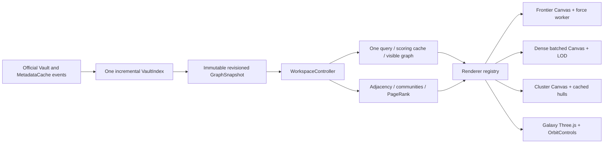

# Unified Graph Workspace

Ripple owns its graph state. No other graph plugin is required. The 0.1
read-only/detection adapters remain regression-tested source modules but are
not imported into the 0.2 production entry point or exposed as mode engines.

## Data and revisions

`core/types.ts` retains the original scoring data. Nodes now carry an explicit
vault path; resolved directed edges carry kind and positive occurrence weight.
The scoring adjacency is intentionally undirected and deduplicated. File
opening uses the actual path; no guessed filename or renderer index is used.

`GraphIndex` owns normalized immutable nodes and outgoing edges. Unchanged
upserts do not advance revision; deletes remove incident edges. A snapshot is
cached at its revision, with a timestamp, sorted nodes and valid endpoints.
`VaultIndex` is the only production metadata reader. Metadata-change events
invalidate specific paths. Creation/deletion/rename reconcile file identities;
resolved-link events refresh lightweight link metadata. Body strings are
optional and bounded, with mtime/size cache keys. Slider and mode events never
read the Vault. Large initial indexing yields periodically to the host.

One plugin-owned `WorkspaceController` subscribes to snapshots. It creates a
fresh scoring cache only on snapshot change, computes analysis once, preserves
surviving selections/positions, and publishes one VisibleGraph. Strict
thresholds use the same inclusive comparison in all modes. No renderer parses
queries or independently filters nodes. There is no implicit bridge exception.
See [SCORING.md](SCORING.md).

## Views, layouts and lifetime

The native ItemView opens in a regular workspace tab. The historic view type
and command ID are preserved for upgrades. Filter and selection are shared;
each mode owns independent positions, pins, camera/target and zoom. Switching
disposes the active renderer and retains its state. Filtering does not restart
Frontier physics or reseed layout. Active physics can continue moving unpinned
nodes, independently of the slider.

Frontier uses an embedded Blob Worker with deterministic seeded d3-force,
Barnes–Hut repulsion, link attraction and collision for graphs up to 10,000
nodes. Above that collision is omitted to bound cost. It supports node drag,
pin/unpin, pan, zoom and fit. A worker creation/error leaves navigation and the
existing layout available, with an explicit notice. A mode switch terminates
the worker and revokes its object URL.

Dense uses a deterministic grid, batches point paths, culls offscreen nodes,
hides edges below 0.3× and caps drawn links at 30,000. It draws at most 120
labels. This is a pragmatic Canvas mode, not Pixi.js or a claim of equivalent
upstream rendering throughput.

Cluster uses full-folder-seeded, deterministic label propagation (up to eight
passes), independent of filtering. Its grouping is a heuristic, not Louvain.
It caches visible community hulls in world coordinates, reprojects them on
camera changes, colors communities, marks cross-community links and supports
community selection. Up to 200 hulls and 10,000 highlighted bridge links are
drawn. The base edge budget is 30,000; all semantic node/edge counts remain
untruncated. No crossing-minimization guarantee is made.

Galaxy uses true xyz positions, a perspective camera, buffered Three.js Points
and LineSegments, ray picking and OrbitControls. The deterministic 3D layout is
a sphere with hashed radial depth; it is not a 3D force solver. Drag orbits,
right-drag pans, the wheel zooms. All eligible nodes enter geometry. Lines are
limited to 100,000, or 5,000 above 10,000 visible nodes, to reduce overdraw.
Missing WebGL 2 and context loss have explicit errors and a working mode
selector for recovery. Large software-WebGL context creation can be slow;
see the measured performance record.

Workspace state persists mode, each camera and pinned Frontier positions
through the official Workspace serialization API. Unpinned force positions are
recomputed after restart. Query strings, selection and body contents are
memory-only. Closing one view releases its renderer/subscriptions; disabling
the plugin also disposes the shared index/controller and all listeners. No
other plugin's settings, renderer, layout files or state is touched.

## Dependency and source boundaries

Three.js (MIT) and d3-force (ISC) are the two direct runtime dependencies.
Three.js and OrbitControls are bundled in main.js. d3-force and its dispatch,
quadtree/timer dependencies are bundled into the embedded worker string. There
are no separate runtime chunks, CDN imports, downloaded fonts or assets.
Required upstream copyright and full license text are retained in main.js.
Build metadata inventories both main and worker inputs.

No code from the four reference plugin repositories was copied. The rationale,
exact source commits, dependencies and rejected extraction boundaries are in
[UPSTREAM_ENGINE_AUDIT.md](UPSTREAM_ENGINE_AUDIT.md). The design adopts useful
boundaries without adopting a second plugin lifecycle, index or persistence
system. [THIRD_PARTY_NOTICES.md](../THIRD_PARTY_NOTICES.md) distinguishes source,
bundled library code and development tooling.
